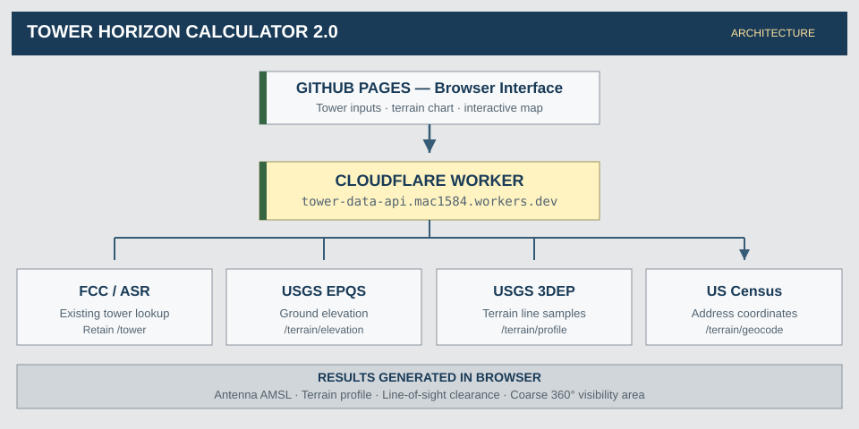
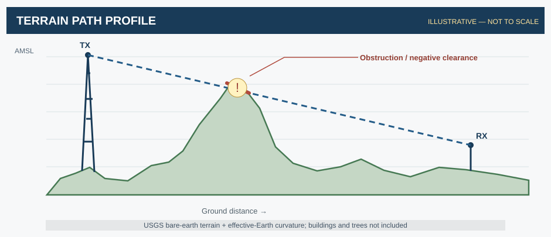
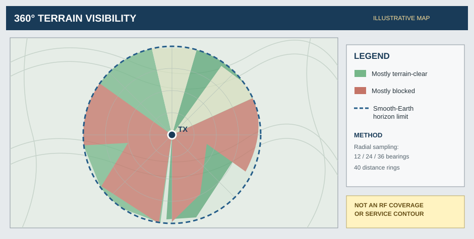

# Tower Horizon Calculator 2.0

**USGS 3DEP terrain-aware radio-horizon and line-of-sight planning tool**  
**VERSION 2.0 · STATUS: BETA** — Waypoint Utility Web

[Live Version 1.9](https://mac1584.github.io/tower-horizon/) · [Version 2.0 draft pull request](https://github.com/Mac1584/tower-horizon/pull/1) · [Cloudflare setup SOP](docs/CLOUDFLARE_SETUP_SOP.md) · [Staging release checklist](docs/STAGING_RELEASE_CHECKLIST.md)

> **Release-candidate status:** Version 2.0 is on the `feature/terrain-v2-usgs` branch. A separate `staging/terrain-v2` branch points terrain requests to the already deployed `tower-terrain-staging` Worker for Cloudflare Pages staging previews. The live GitHub Pages website remains v1.9, and the production FCC Worker is unchanged. The 360-degree map/PDF exports were tested in Chrome, but the newest point-to-point report and recovery flow still need browser acceptance testing. See [staging checklist](docs/STAGING_RELEASE_CHECKLIST.md).

## Two primary use cases

1. **360-degree site visibility:** sample terrain surrounding one transmitter or other reference location in 12, 24, or 36 directions; display clear, obstructed and unknown sector/ring cells; export CSV/KML/map images and a one-page PDF report. This workflow can support broadcast and nonbroadcast planning.
2. **Point-to-point geometric connectivity:** test a specific link between two antenna locations with independent heights above ground. Measure the sampled terrain clearance, distance, bearings and elevation profile. **Download Two-way Link PDF** creates a separate one-page Letter report with a north-up map, the actual A-to-B path and **one 30-degree orientation sector centered on the path**. The context sector is *not* modeled coverage or antenna beamwidth; geometric clearance does not predict RF link reliability.

## Why this tool exists

A simple radio-horizon calculation estimates how far a tower can theoretically see over a smooth Earth. Actual terrain is rarely smooth. A mountain or ridge can block an otherwise plausible path; an elevated receiving location may become visible beyond an intermediate obstruction.

Tower Horizon Calculator 2.0 adds terrain elevation data to the existing broadcast-tower calculator. It answers a more useful set of preliminary planning questions:

- What is the transmitter's approximate **ground elevation** according to USGS?
- What is the estimated **antenna center elevation above mean sea level (AMSL)**?
- Is the sampled radio path between a transmitter and receiver **clear of modeled terrain**?
- How much extra **transmitter or receiver antenna height** might be required to clear sampled terrain?
- Which surrounding directions and distance rings appear **terrain-visible** within the smooth-Earth radio horizon?

**This is an educational planning tool, not a service-coverage prediction or FCC engineering certification.**

## System architecture



| Layer | Technology | Responsibility |
|---|---|---|
| Website | GitHub Pages, HTML/CSS/JavaScript | Inputs, original horizon calculator, visualization, results |
| Backend | Cloudflare production `tower-data-api` and separate staging `tower-terrain-staging` | Keep FCC production stable while testing terrain routes |
| Elevation | USGS Elevation Point Query Service (EPQS) | Ground elevation at a transmitter coordinate |
| Profiles | USGS 3DEP ImageServer `getSamples` | Existing polyline path lookups; new 48-point multipoint sampling for radial scans in staging |
| Address lookup | U.S. Census Geocoder | Optional receiver street-address location |
| Maps | Leaflet and OpenStreetMap tiles | Receiver selection and schematic viewshed overlay |
| Analysis | JavaScript | Curvature-adjusted path, clearance, height and viewshed estimates |

The existing `/tower` FCC route must be preserved. The repository contains a new `worker-terrain-extension.js` module, but **not** the source of the original deployed FCC Worker.

## Features and operator instructions

### 1. FCC and original smooth-Earth horizon calculator

1. Enter a seven-digit FCC Antenna Structure Registration Number (example: `1004233`) and select **Look Up FCC**, or enter manual tower/receiver values.
2. Check the registered tower height, estimated radiation center height, receiver height and base elevation.
3. Read the standard radio horizon (`k = 4/3`), geometric horizon (`k = 1`), theoretical circular area, and antenna center AMSL.

The Location input is now first and accepts decimal coordinates, complete U.S. street addresses or five-digit ZIP codes. An address or ZIP lookup is approximate; review the coordinates before treating them as a tower site. The FCC ASRN input sits below Location in a smaller panel.

The existing eight-meter antenna setback is a convenience approximation, **not** the actual licensed radiation-center height. Use the actual transmitting antenna center AGL whenever available.

### 2. Ground elevation and transmitter AMSL

1. In **USGS 3DEP — Terrain & Line-of-Sight Analysis**, enter transmitter latitude and longitude. An FCC lookup with valid coordinates should populate these fields.
2. Select **Load USGS Elevation**.
3. Review **Ground elevation** and **Antenna center AMSL**.
4. Optionally select **Copy to Base Elevation** to update the original calculator's base elevation field.

The estimated antenna elevation is:

```text
Antenna center AMSL (ft)
  = USGS ground elevation (m) × 3.280839895
    + radiation center height AGL (ft)
```

### 3. Terrain profile and line of sight



1. Set a receiver by **clicking the map**, manually entering latitude/longitude, or finding a complete U.S. street address through the Census geocoder.
2. Verify the main calculator's receiver antenna height in feet AGL.
3. Choose `k = 4/3` (standard refraction approximation) or `k = 1` (geometric, no refraction).
4. Select 48, 72 or 120 samples, then **Analyze Selected Path**.
5. Read the plotted ground profile, modeled radio path, minimum clearance, blocked/clear classification, and an approximate extra antenna height needed at either endpoint.

The profile corrects apparent terrain for an effective-Earth-curvature bulge:

```text
terrain_bulge(x) ≈ x × (D − x) / (2 × k × R)

modeled_clearance(x)
  = interpolated_antenna_line(x)
    − USGS_ground_elevation(x)
    − terrain_bulge(x)

where:
  x  = distance from transmitter along the path (meters)
  D  = total transmitter–receiver path length (meters)
  k  = effective-Earth-radius factor (default 4/3)
  R  = Earth radius ≈ 6,371,000 meters
```

A **negative sampled minimum clearance** indicates a modeled terrain obstruction. Additional transmitter and receiver height suggestions are **alternative changes** to clear sampled terrain and omit diffraction/Fresnel-zone considerations. Sample gaps or unknown elevations should prevent a confident result.

### 4. Coarse 360-degree terrain visibility map



1. Check that transmitter coordinates and heights are correct.
2. Select 12, 24 or 36 compass bearings; start with **12** for a faster initial check.
3. Select **Calculate Terrain-Visible Area**.
4. The application retrieves radial terrain samples and classifies 40 distance rings along each bearing. It colors schematic cells based on neighboring ring/bearing visibility:
   - **Green:** predominantly terrain-visible samples.
   - **Red:** predominantly terrain-obstructed samples.
   - **Gray:** missing or unverifiable terrain data.
   - **Blue dashed circle:** smooth-Earth radio-horizon limit.
5. Examine the approximate terrain-visible area in square miles. If any required radial terrain data are missing, results indicate **Incomplete** instead of reporting a definitive area estimate. The 12-bearing fastest mode uses four chunks of three radials, 48 sampling positions per radial; the [multipoint staging rollout](docs/MULTIPOINT_STAGING_ROLLOUT.md) is designed to fix all requested positions, including both endpoints.

This map is deliberately coarse. Boundary sectors, narrow valleys, ridges, buildings, trees, field strength, antennas and propagation loss are not fully represented. Its area is **not** a regulatory signal-coverage contour, number of households served, or predicted audience.

*All three drawings are illustrations for explanation, not USGS-calculated results.*

## Repository files

| File | Purpose |
|---|---|
| `index.html` | Web app with original calculator and new terrain panels |
| `script.js` | Existing smooth-Earth horizon math and FCC lookup; dispatches valid FCC coordinates |
| `terrain.js` | USGS calls, address selection, path visibility, profile SVG chart, coarse 360-degree view and structured export snapshots |
| `export.js` | CSV, KML, JPEG and PDF exports, including the 360-degree one-page report |
| `path-report.js` | Independent one-page two-way point-to-point PDF with selected-path map, 30-degree orientation sector and a vector elevation chart |
| `tests/check-static.mjs` | Dependency-free Node syntax and staging integration smoke checks |
| `docs/STAGING_RELEASE_CHECKLIST.md` | Staging branch, Cloudflare Pages test hosting, acceptance and safeguarded production rollout |
| `recovery.html` / `recovery.js` | Optional five-minute stand-alone same-origin retry window for transient terrain errors |
| `docs/RABBITEARS_MAP_RESEARCH.md` | Public RabbitEars contour/Leaflet/SPLAT research notes for future map enhancements |
| `style.css` | Calculator/terrain layouts, map and charts |
| `waypoint.css` | Shared dark-navy and gray Waypoint Utility Web visual system |
| `worker-terrain-extension.js` | **Integration module only**; adds USGS/Census routes to existing Worker |
| `cloudflare/staging-multipoint-handler.js` | New self-contained `/terrain/multipoint` route to append to the existing **staging** Worker |
| `docs/MULTIPOINT_STAGING_ROLLOUT.md` | Safe, staged deployment and PowerShell verification of multipoint sampling |
| `docs/CLOUDFLARE_SETUP_SOP.md` | Step-by-step setup, validation, staging, deployment and rollback |
| `docs/diagrams/architecture.svg` | System architecture diagram |
| `docs/diagrams/terrain-profile.svg` | Terrain line-of-sight diagram |
| `docs/diagrams/coverage-map.svg` | 360-degree visibility map diagram |

## Version 2.0 recovery and error handling (development branch)

The 360-degree scan requests at most three USGS terrain profiles concurrently and splits an uncached 12-bearing scan into four chunks. All multipoint profiles have 48 explicitly requested coordinates.

- Successful profiles are validated and cached in browser memory. Network/service errors are not cached.
- A temporary HTTP **408, 429, 500, 502, 503, 504**, network failure, or timeout triggers at most **two automatic retries** with short delays. Missing or invalid elevation positions do **not** trigger automatic retries.
- If transient errors remain after the two automatic retries, the completed scan shows an optional **Open 5-minute recovery window** button. It opens `recovery.html` only after a user click. The separate window retries **only the failed transient bearings**, **one request at a time**, for no longer than five minutes; closing or stopping it ends the session.
- The popup sends results only to the original same-origin calculator and accepts configuration only from that window. The original page verifies returned coordinates and elevation values before caching them, then **recalculates the map from the cache without new USGS calls**.
- Unknown terrain remains gray and total terrain-visible area stays **Incomplete** until every required radial is verified. The pop-up may be blocked by browser settings; in that case no new requests run.
- Production workers and the existing selected-path analysis are not modified by these features.

## Version 2.0 UX and export features (development branch)

- **Location first:** the primary Location field accepts latitude/longitude pairs, complete U.S. street addresses, or five-digit ZIP codes. Street-address matches use the official U.S. Census JSONP geocoder because the Census API does not support direct browser CORS; geocodes are approximate and need confirmation. ZIP codes use an approximate geographic center from Zippopotam.us. The FCC ASRN lookup is optional and appears in a smaller panel below.
- **Background styling:** choose a muted grayscale OpenStreetMap background or the regular color tiles. The terrain overlay is more saturated and opaque so green/blocked/gray sectors remain distinct; attribution stays visible.
- **CSV:** download the 360° radial profile samples, elevations, and per-ring line-of-sight classifications, with scan metadata and errors.
- **KML:** export colored coverage polygons, including gray unknown sectors, for use with Google Earth and compatible applications. KML represents preliminary modeled terrain visibility, not FCC contour data.
- **Map JPEG and Map PDF:** export the current displayed map. The browser first attempts to capture displayed tiles with html2canvas; where browser/cross-origin restrictions prevent this, it exports a clearly labeled schematic map with the actual overlay instead.
- **360-degree one-page PDF:** creates a one-page **US Letter (8.5 × 11 in)** report with transmitter inputs, terrain-visible area, map, and coverage-test diagnostics. Reports flag unknown/incomplete terrain analysis.
- **Two-way Point-to-Point PDF:** after Analyze Selected Path, a separate one-page Letter report includes individual endpoint elevations/heights, distance, true bearings in both directions, minimum sampled clearance, height-adjustment options, a detailed elevation profile and a map containing **only one 30-degree orientation sector and the tested path** (no 360-degree overlay).

The map-export renderer first captures OpenStreetMap tiles, then composites **verified scan-cell geometry on a new canvas**. This avoids a browser rendering problem in which html2canvas leaves transformations that make the terrain overlay invisible when painted on its original context. The PDF download status reports the number of terrain cells drawn. The exported terrain layer and dashed theoretical horizon are derived from the same scan data used by CSV/KML. Map image and PDF exports run in the browser and use pinned html2canvas 1.4.1 and jsPDF 2.5.2. jsPDF loads from the npm-backed jsDelivr URL, with an on-demand unpkg fallback if the initial CDN fails. No export uploads your data to a separate server. Map tiles remain subject to OpenStreetMap attribution and usage policy. Use caution: grayscale styling is a visual filter on the existing OSM raster tiles, not a separate map service.

## Getting started

### Preview the frontend

Download or check out the feature branch and open a local web server:

```powershell
git clone --branch feature/terrain-v2-usgs https://github.com/Mac1584/tower-horizon.git
cd tower-horizon
npx --yes serve . -l 8000
```

Then visit `http://localhost:8000/`. The original numerical horizon calculator works locally. However, network-backed features require the FCC Worker and successful USGS/Census requests. The frontend attempts the new Worker routes first and may fall back to browser-direct public endpoints, which **can be blocked by CORS**.

### Set up the existing Cloudflare Worker

**Follow the [Cloudflare Setup SOP](docs/CLOUDFLARE_SETUP_SOP.md) before deploying.** At a high level:

1. Recover and back up the existing `tower-data-api` Worker source and bindings.
2. Copy `worker-terrain-extension.js` into that Worker project.
3. Import `handleTerrainRequest` and call it at the beginning of the current fetch handler, leaving existing `/tower` code untouched.
4. Test all routes using `npx wrangler dev`.
5. Deploy a **separate staging Worker**, validate the site, and only then approve a production Worker change.
6. Merge the GitHub Pages feature branch only after a successful backend release.

Cloudflare's preferred config for *new* Workers is `wrangler.jsonc`; preserve the existing service's config unless deliberately migrating it. A Wrangler deploy does not automatically update the GitHub Pages repository, and a GitHub Pages merge does not automatically update the existing Cloudflare Worker.

## API reference

Current original API:

```text
GET https://tower-data-api.mac1584.workers.dev/tower?asrn=1004233
```

New routes after integration:

```http
GET /terrain/elevation?lat=42.29&lon=-71.23

POST /terrain/profile
Content-Type: application/json

{
  "tx": { "lat": 42.29, "lon": -71.23 },
  "rx": { "lat": 42.3601, "lon": -71.0589 },
  "samples": 72
}

GET /terrain/geocode?address=24%20Beacon%20St%2C%20Boston%2C%20MA
```

The elevation endpoint should return a finite `elevationMeters`, the profile endpoint should return a `samples` array with valid elevations and locations, and the address endpoint returns the Census Geocoder result object. Routes are **not active in production** until the Worker extension is integrated and deployed.

## Test checklist

- [ ] Preserve existing FCC lookup and standard/geometric horizon values.
- [ ] Verify Needham, Massachusetts, sample coordinates `42.29, -71.23`.
- [ ] Verify a USGS point elevation and antenna AMSL arithmetic.
- [ ] Verify transmitter coordinates update after a successful FCC lookup.
- [ ] Verify manual receiver coordinates, geocoding and map click selection.
- [ ] Validate a full terrain profile, sample count and negative-clearance example.
- [ ] Compare `k=1` and `k=4/3` and changes to TX/RX heights.
- [ ] Validate 12-bearing and 24-bearing viewsheds and error handling.
- [ ] Validate USGS timeouts, missing data, CORS, responsive layout and keyboard use.
- [ ] Independently cross-check representative terrain profiles and area estimates.
- [ ] Test staging first; document approvals before production deployment.

## Assumptions, scope and safety

This beta is designed for preliminary RF/site-planning education. It does not provide a licensed antenna pattern, frequency-specific propagation, ERP, buildings/trees, clutter, weather anomalies, Fresnel clearance, interference, HAAT-based FCC contours, receiver sensitivity, or reception guarantees.

USGS 3DEP is an elevation source, not an RF propagation model. The data's resolution and vertical datum vary by source. A sampled clear path can still be obstructed between sample points or by nonterrain obstacles. The approximate area calculation is a polar-grid approximation; it should not be used for public-safety, tower-siting, aviation, infrastructure-certification or regulatory decisions without appropriate professional study.

The current Worker extension has permissive CORS and no rate limiting. Protect or constrain publicly accessible upstream proxy routes and monitor Cloudflare/USGS consumption before widespread use.

## Roadmap

1. **Now:** Connect EPQS and the 3DEP profile service; test the Worker integration and frontend end-to-end.
2. **Next:** Validate improved terrain sampling; cache repeat profiles and make partial-failure reporting clearer.
3. **Later:** Replace coarse radial sampling with more robust DEM/tile-based viewshed processing, then intersect terrain-visible geography with Census blocks for population estimates.
4. **Future:** Fresnel clearance, frequency-aware modeling and exportable engineering reports.

## Data credits & documentation

- [USGS 3D Elevation Program](https://www.usgs.gov/3d-elevation-program)
- [USGS EPQS API](https://epqs.nationalmap.gov/v1/docs)
- [USGS 3DEP ImageServer](https://elevation.nationalmap.gov/arcgis/rest/services/3DEPElevation/ImageServer)
- [FCC antenna structure registration](https://www.fcc.gov/wireless/support/antenna-structure-registration-asr-resources)
- [U.S. Census Geocoder](https://geocoding.geo.census.gov/geocoder/)
- [Cloudflare Workers](https://developers.cloudflare.com/workers/)
- [Leaflet](https://leafletjs.com/)
- [OpenStreetMap](https://www.openstreetmap.org/)

**Waypoint Utility Web · Tower Horizon Calculator · Version 2.0 / BETA**

No endorsement by USGS, FCC, U.S. Census Bureau, Cloudflare, or any other data provider is implied.
