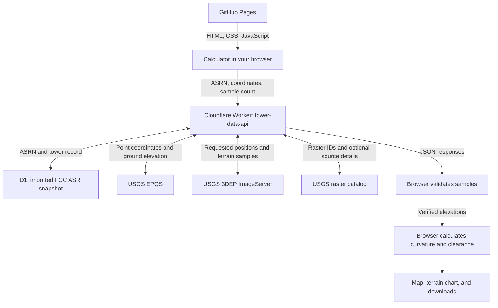

# Tower Horizon Calculator 2.0

**Radio horizons, terrain visibility, and point-to-point line of sight**

**VERSION 2.0 · STATUS: BETA** · Waypoint Utility Web

[Open the calculator](https://mac1584.github.io/tower-horizon/) · [Report an issue or suggest an improvement](https://github.com/Mac1584/tower-horizon/issues) · [Production release record](docs/PRODUCTION_RELEASE_2026-10-29.md)

How far can that tower see? Enter a location and antenna heights to estimate the smooth-Earth horizon, explore surrounding terrain, or examine the geometric path between two sites.

The Earth keeps curving, even when that is inconvenient for the spreadsheet.

## What you can do

| Tool | What it provides |
|---|---|
| **Horizon calculator** | Standard radio horizon, geometric horizon, theoretical circular area, and antenna elevation above mean sea level. |
| **360° terrain visibility** | A coarse map of terrain-clear, terrain-blocked, and unknown cells around one site, using 12, 24, or 36 bearings. |
| **Point-to-point analysis** | A sampled terrain profile between two sites, forward/reverse bearings, minimum geometric clearance, and alternative antenna-height adjustments. |

Export 360° samples as **CSV**, map cells as **KML**, maps as **JPEG/PDF**, and separate one-page **US Letter PDF reports** for site visibility and point-to-point analysis. Reports include available USGS source information and calculator sample spacing.

The tool is built around U.S. FCC tower records, U.S. location helpers, and USGS terrain services. It supports preliminary exploration for broadcast and other radio/site-planning uses.

## Try it

1. Open the [live calculator](https://mac1584.github.io/tower-horizon/). Enter coordinates, a complete U.S. street address, or a ZIP code and select **Locate**. Alternatively, enter an FCC ASRN such as **1004233** and select **Look Up FCC**.
2. Confirm the location and antenna heights. Use the actual antenna radiation center above ground when available. The automatic tower-top-minus-8-meters estimate is a convenience assumption.
3. Choose a study:

| Study | Steps |
|---|---|
| **Around one site** | Confirm the transmitter elevation, choose **12 bearings** for an initial scan, and select **Calculate Terrain-Visible Area**. |
| **Between two sites** | Set the receiver by coordinates, address, or map click; check its height; choose **72 samples** and select **Analyze Selected Path**. |

A ZIP code identifies an approximate geographic center; a geocoded address is also approximate. Review the map before treating either as the actual antenna location.

Start with 12 bearings. That scan requests **576 terrain positions** in 12 radial queries, processed in four chunks of three. A 24- or 36-bearing scan requests 1,152 or 1,728 positions. Service response times vary, and verified profiles may be reused from browser memory.

## How it works, including the USGS data flow

GitHub Pages delivers the application files. Your browser sends tower and terrain requests to the existing Cloudflare Worker, then validates the returned elevations and performs the engineering calculations locally.



**Reading the USGS portion:**

- **EPQS** provides ground elevation at a coordinate, including the transmitter elevation lookup.
- **3DEP ImageServer** samples requested positions along each path. The preferred multipoint route includes both endpoints and returns elevations plus available raster IDs, DEM resolution, and source attributes.
- **The raster catalog** supplies optional project details for raster IDs when needed, including acquisition dates only when explicitly provided. Missing source metadata does not change the geometric calculation.

The browser checks sample count, coordinates, order, and elevation values before accepting a multipoint profile. Point-to-point analysis requires complete verified multipoint sampling. Unknown terrain cannot earn a green cell through positive thinking.

**Other browser requests:** U.S. addresses use the Census Geocoder through a browser JSONP fallback; ZIP lookup uses Zippopotam.us; map tiles come from OpenStreetMap. Those helpers locate sites or draw the background. They do not supply the terrain elevation model. A limited browser-direct USGS fallback remains for unavailable legacy proxy routes; normal production terrain requests use the Worker.

**FCC records are a snapshot:** the Worker reads imported records from Cloudflare D1, rather than querying the FCC live for each visitor. Lookup results identify the record's import date.

**Exports stay in the browser:** map rendering and report generation run locally in the page. Input coordinates are sent to the services needed for lookups and analysis; generated reports are not uploaded to a separate export server.

## Understanding the results

| Result | How to read it |
|---|---|
| **Radio horizon** | Smooth-Earth estimate using an effective Earth-radius factor of `k = 4/3`. |
| **Geometric horizon** | Smooth-Earth estimate using `k = 1`. |
| **Terrain-clear / blocked** | Classification of sampled terrain with the selected curvature model. It does not predict received signal strength. |
| **Gray / Incomplete** | Required terrain data are missing or unverifiable. A reliable total visible-area estimate is withheld. |
| **Height adjustment** | Alternative additional height at either endpoint to clear the sampled terrain. The model omits Fresnel-zone clearance and other RF effects. |

Heights are **AGL** (above ground level); elevations are **AMSL** (above mean sea level). Ground elevation is used to calculate antenna AMSL and the terrain path; it is not simply added to antenna AGL for the smooth-Earth horizon calculation.

The horizon calculation uses `√(2kRh)` at each endpoint, with Earth radius `R = 6,371,000 m`. For heights in feet and distances in miles, the rounded forms are:

```text
Radio horizon     ≈ 1.415 × (√TX_height + √RX_height)
Geometric horizon ≈ 1.225 × (√TX_height + √RX_height)

Terrain curvature bulge at distance x along a path of length D:
bulge(x) ≈ x × (D − x) / (2 × k × R)
```

### DEM resolution and calculator spacing are different

A reported **1 m DEM resolution** describes the source raster. It does not mean the calculator checked every meter of a path.

A 360° radial uses **48 requested positions**; a point-to-point path offers **48, 72, or 120**. Spacing depends on path length. Reports keep source resolution and calculator spacing separate, and may identify multiple source projects or resolutions within one study.

The point-to-point PDF's **30° orientation sector** is visual context around the measured centerline. It is not a modeled antenna beamwidth or coverage prediction.

## Errors, retries, and current limits

Successful verified profiles are cached in browser memory. Temporary service/network failures during a 360° scan receive up to **two automatic retries**. Missing or invalid elevations remain unknown.

If temporary failures remain, an optional **five-minute recovery window** can retry only the failed transient bearings, one at a time. It opens only after a user clicks its button. The main page validates returned data before recalculating from its cache.

USGS occasionally takes a coffee break. The map waits for actual elevations rather than filling the gaps with enthusiasm.

This Beta models sampled bare-earth geometry. It omits buildings, trees, clutter, Fresnel clearance, diffraction, frequency-specific propagation, transmitter power, antenna patterns, interference, and receiver sensitivity. Narrow ridges or valleys can fall between samples. A green map cannot sign off on your project.

The visible-area estimate is a coarse approximation within the smooth-Earth horizon, not an FCC contour, guaranteed reception area, or measured audience. Population and population-density fields are placeholders awaiting a future data integration.

## Development

The production frontend is the repository's **`main` branch**. No frontend build step is required.

```powershell
git clone https://github.com/Mac1584/tower-horizon.git
cd tower-horizon
npx --yes serve . -l 8000
```

Open `http://localhost:8000/`. Horizon math runs in the browser; lookups, terrain sampling, basemap tiles, and some libraries require network access.

| Files | Responsibility |
|---|---|
| `index.html`, `style.css`, `waypoint.css` | Interface and shared Waypoint Utility Web styling. |
| `script.js` | Horizon math, FCC lookup, and transmitter location helpers. |
| `terrain.js` | Elevation requests, sample validation, path calculations, map cells, caching, and retries. |
| `terrain-sources.js` | Aggregates reported DEM resolution and source metadata; optional catalog enrichment. |
| `export.js`, `path-report.js` | Browser-generated maps, CSV/KML, and the two one-page reports. |
| `recovery.html`, `recovery.js` | Optional same-origin recovery window. |
| `cloudflare/production-worker-v2-candidate.js` | Complete deployed production Worker source, including FCC/D1 and USGS routes. The filename/header retain their historical candidate wording. |
| `cloudflare/staging-worker-v2-provenance.js` | Separate terrain-only staging Worker source. |
| `tests/`, `docs/` | Automated checks, methods, release evidence, and deployment history. |

The older `worker-terrain-extension.js` and `cloudflare/staging-multipoint-handler.js` are integration helpers. Use the complete production Worker source when maintaining the FCC-backed production service.

### Current production API

Base URL: `https://tower-data-api.mac1584.workers.dev`

| Method | Route | Purpose |
|---|---|---|
| GET | `/` | Diagnostic status and database-binding presence. |
| GET | `/tower?asrn=1004233` | Tower record from the imported FCC snapshot. |
| GET | `/terrain/elevation?lat=42.30297222&lon=-71.21802778` | USGS point elevation. |
| POST | `/terrain/multipoint` | Explicit path positions with elevations, missing indices, completeness, and available source metadata. |
| POST | `/terrain/profile` | Legacy polyline profile retained for compatibility. |
| GET | `/terrain/catalog?ids=88413` | Optional USGS source metadata for 1–24 raster IDs per request. |

Both POST routes accept a JSON body with `tx`, `rx`, and `samples`:

```json
{
  "tx": { "lat": 42.30297222, "lon": -71.21802778 },
  "rx": { "lat": 42.3601, "lon": -71.0589 },
  "samples": 72
}
```

Use **`/terrain/multipoint`** for the current point-to-point workflow. Its response includes `requestedCount`, `returnedCount`, `complete`, `missingIndices`, and ordered `samples`. Optional `rasterId`, `resolution`, and `sourceDetails` fields describe the data source.

### Checks and release evidence

Use **Node.js 22 or later** to run the dependency-free checks:

```powershell
node tests/check-static.mjs
node tests/check-worker-candidate.mjs
node tests/check-staging-worker.mjs
node tests/check-point-to-point.mjs
node tests/check-terrain-sources.mjs
node tests/check-360-provenance.mjs
node tests/check-360-pdf.mjs
```

These checks cover syntax/wiring, mocked Worker contracts, rejection of incomplete path data, source metadata, and 360° report generation. They do not replace live service or browser testing.

**October 29, 2026 release:** all seven checks passed. Fresh production FCC/elevation lookups, a 72-point Needham-to-Boston path, and a 12-bearing/576-position scan passed. Both PDF export controls completed successfully; the production PDFs were not independently re-rendered during that pass. Earlier hosted PDF visual reviews and automated export regressions are documented in the [release record](docs/PRODUCTION_RELEASE_2026-10-29.md).

**Open acceptance item:** the optional five-minute recovery window still needs a live transient-failure test.

### Deployment and maintenance

GitHub Pages publishes the frontend from `main`. Cloudflare serves the production data API through `tower-data-api`, with **`DB` bound to `tower-records`**. Pushing this repository does not deploy the Worker.

The existing Cloudflare Pages staging site and `tower-terrain-staging` Worker remain separate test environments. The production FCC Worker and terrain-only staging Worker have different responsibilities.

The current Worker source uses permissive CORS and has no application-level rate limiter. Monitor Cloudflare request volume and USGS availability as usage grows.

For Worker changes, preserve the current source, version, and bindings; validate a saved inactive version; promote it only after checks pass; then verify the public site. The [production release record](docs/PRODUCTION_RELEASE_2026-10-29.md) identifies the deployed version and rollback checkpoint.

- [Production Worker integration and historical rollout procedure](docs/PRODUCTION_WORKER_INTEGRATION.md)
- [USGS provenance design and rollout history](docs/USGS_TERRAIN_PROVENANCE.md)
- [Staging acceptance history](docs/STAGING_RELEASE_CHECKLIST.md)

## Feedback and next work

[Open a GitHub issue](https://github.com/Mac1584/tower-horizon/issues) for a bug, question, or feature suggestion. For reproducible results, include the location/ASRN, antenna heights, `k` value, sample/bearing settings, expected behavior, and the error or screenshot.

Next work includes live recovery acceptance, finer terrain analysis and additional RF modeling, and population estimates based on terrain-visible geography. Completed map/report exports and multipoint sampling are part of the current release.

## Data credits

[USGS 3DEP](https://www.usgs.gov/3d-elevation-program) · [USGS EPQS](https://epqs.nationalmap.gov/v1/docs) · [USGS ImageServer](https://elevation.nationalmap.gov/arcgis/rest/services/3DEPElevation/ImageServer) · [FCC ASR](https://www.fcc.gov/wireless/support/antenna-structure-registration-asr-resources) · [U.S. Census Geocoder](https://geocoding.geo.census.gov/geocoder/) · [Zippopotam.us](https://www.zippopotam.us/) · [Leaflet](https://leafletjs.com/) · [OpenStreetMap](https://www.openstreetmap.org/) · [Cloudflare Workers](https://developers.cloudflare.com/workers/)

Map attribution remains visible in the application and exports. This independent project is not endorsed by the listed agencies or services.

Always consult a professional engineer.
