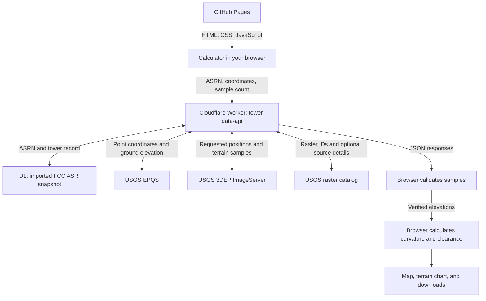

# Tower Horizon Calculator 2.0

**Radio horizons, terrain visibility, and point-to-point line of sight**

**VERSION 2.0 · STATUS: BETA** · Waypoint Utility Web

[Open the calculator](https://mac1584.github.io/tower-horizon/) · [Report an issue or suggest an improvement](https://github.com/Mac1584/tower-horizon/issues) · [Production release record](docs/PRODUCTION_RELEASE_2026-10-29.md)

How far can that tower see? Enter a location and antenna heights to estimate the smooth-Earth horizon, explore surrounding terrain, or examine the geometric path between two sites.

The Earth keeps curving, even when that is inconvenient for the spreadsheet.

## What you can do

| Tool | What it provides |
|---|---|
| **Horizon calculator** | Standard radio horizon, geometric horizon, theoretical circular area, and antenna elevation above mean sea level. |
| **360° terrain visibility** | A coarse map of terrain-clear, terrain-blocked, and unknown cells around one site, using 12, 24, or 36 bearings. |
| **Point-to-point analysis** | A sampled terrain profile between two sites, forward/reverse bearings, minimum geometric clearance, and alternative antenna-height adjustments. |

Export 360° samples as **CSV**, map cells as **KML**, maps as **JPEG/PDF**, and separate one-page **US Letter PDF reports** for site visibility and point-to-point analysis. Reports include available USGS source information and calculator sample spacing.

The tool is built around U.S. FCC tower records, U.S. location helpers, and USGS terrain services. It supports preliminary exploration for broadcast and other radio/site-planning uses.

## Try it

1. Open the [live calculator](https://mac1584.github.io/tower-horizon/). Enter coordinates, a complete U.S. street address, or a ZIP code and select **Locate**. Alternatively, enter an FCC ASRN such as **1004233** and select **Look Up FCC**.
2. Confirm the location and antenna heights. Use the actual antenna radiation center above ground when available. The automatic tower-top-minus-8-meters estimate is a convenience assumption.
3. Choose a study:

| Study | Steps |
|---|---|
| **Around one site** | Confirm the transmitter elevation, choose **12 bearings** for an initial scan, and select **Calculate Terrain-Visible Area**. |
| **Between two sites** | Set the receiver by coordinates, address, or map click; check its height; choose **72 samples** and select **Analyze Selected Path**. |

A ZIP code identifies an approximate geographic center; a geocoded address is also approximate. Review the map before treating either as the actual antenna location.

Start with 12 bearings. That scan requests **576 terrain positions** in 12 radial queries, processed in four chunks of three. A 24- or 36-bearing scan requests 1,152 or 1,728 positions. Service response times vary, and verified profiles may be reused from browser memory.

## How it works, including the USGS data flow

GitHub Pages delivers the application files. Your browser sends tower and terrain requests to the existing Cloudflare Worker, then validates the returned elevations and performs the engineering calculations locally.



**Reading the USGS portion:**

- **EPQS** provides ground elevation at a coordinate, including the transmitter elevation lookup.
- **3DEP ImageServer** samples requested positions along each path. The preferred multipoint route includes both endpoints and returns elevations plus available raster IDs, DEM resolution, and source attributes.
- **The raster catalog** supplies optional project details for raster IDs when needed, including acquisition dates only when explicitly provided. Missing source metadata does not change the geometric calculation.

The browser checks sample count, coordinates, order, and elevation values before accepting a multipoint profile. Point-to-point analysis requires complete verified multipoint sampling. Unknown terrain cannot earn a green cell through positive thinking.

**Other browser requests:** U.S. addresses use the Census Geocoder through a browser JSONP fallback; ZIP lookup uses Zippopotam.us; map tiles come from OpenStreetMap. Those helpers locate sites or draw the background. They do not supply the terrain elevation model. A limited browser-direct USGS fallback remains for unavailable legacy proxy routes; normal production terrain requests use the Worker.

**FCC records are a snapshot:** the Worker reads imported records from Cloudflare D1, rather than querying the FCC live for each visitor. Lookup results identify the record's import date.

**Exports stay in the browser:** map rendering and report generation run locally in the page. Input coordinates are sent to the services needed for lookups and analysis; generated reports are not uploaded to a separate export server.

## Understanding the results

| Result | How to read it |
|---|---|
| **Radio horizon** | Smooth-Earth estimate using an effective Earth-radius factor of `k = 4/3`. |
| **Geometric horizon** | Smooth-Earth estimate using `k = 1`. |
| **Terrain-clear / blocked** | Classification of sampled terrain with the selected curvature model. It does not predict received signal strength. |
| **Gray / Incomplete** | Required terrain data are missing or unverifiable. A reliable total visible-area estimate is withheld. |
| **Height adjustment** | Alternative additional height at either endpoint to clear the sampled terrain. The model omits Fresnel-zone clearance and other RF effects. |

Heights are **AGL** (above ground level); elevations are **AMSL** (above mean sea level). Ground elevation is used to calculate antenna AMSL and the terrain path; it is not simply added to antenna AGL for the smooth-Earth horizon calculation.

The horizon calculation uses `√(2kRh)` at each endpoint, with Earth radius `R = 6,371,000 m`. For heights in feet and distances in miles, the rounded forms are:

```text
Radio horizon     ≈ 1.415 × (√TX_height + √RX_height)
Geometric horizon ≈ 1.225 × (√TX_height + √RX_height)

Terrain curvature bulge at distance x along a path of length D:
bulge(x) ≈ x × (D − x) / (2 × k × R)
```

### DEM resolution and calculator spacing are different

A reported **1 m DEM resolution** describes the source raster. It does not mean the calculator checked every meter of a path.

A 360° radial uses **48 requested positions**; a point-to-point path offers **48, 72, or 120**. Spacing depends on path length. Reports keep source resolution and calculator spacing separate, and may identify multiple source projects or resolutions within one study.

The point-to-point PDF's **30° orientation sector** is visual context around the measured centerline. It is not a modeled antenna beamwidth or coverage prediction.

## Error handling and recovery

Error handling is layered across the browser, Cloudflare Worker, and export modules. The basic rule is simple: a failed request or missing elevation must not become a confident engineering result.

### Validation and visible errors

| Condition | Current behavior |
|---|---|
| Invalid ASRN, coordinates, antenna heights, or sample settings | Reject the input with a status message before attempting the affected operation. Point-to-point sites must be at least 100 m apart. The Worker also validates its incoming requests. |
| FCC lookup fails or times out | Show the error and retain existing calculator inputs. Manual horizon calculations remain available. |
| Address lookup has no usable match | Show the lookup error and allow coordinates to be entered manually. |
| USGS returns missing, invalid, or misplaced multipoint samples | Reject that profile rather than inventing elevations. A point-to-point result and its PDF require every requested position, including both endpoints. |
| A 360° bearing cannot be verified | Keep its affected sectors gray, label the study **Incomplete**, and withhold a reliable total visible-area estimate. |
| An export fails | Show an export-specific status message, record the technical error in the console, and restore the relevant controls according to the available results. |

### Timeouts and bounded automatic retries

Requests have explicit deadlines: the FCC browser lookup uses **15 seconds**; multipoint requests use **35 seconds** in the browser and **30 seconds** for the Worker's upstream USGS call. These limits apply to individual requests, not the total scan duration.

During a **360° scan**, HTTP **408, 429, 500, 502, 503, and 504**, network failures, and request timeouts are considered transient. Each affected radial gets at most **two automatic retries** after approximately **1.5 and 3.5 seconds**, with a small random delay added. Actual missing or invalid elevations are not retried as temporary outages. Point-to-point analysis reports a failure for the user to address or rerun; it does not use this automatic radial retry loop.

The scanner processes four chunks with at most **three profiles in flight**. If every bearing in the first chunk fails, it stops the remaining chunks instead of continuing a full scan against an unavailable service.

### Caching and result state

Successful verified terrain profiles are retained in browser memory and can be reused on a later scan. Failed terrain requests are not stored as successful profiles. A repeated scan can therefore keep good bearings and request the ones that failed, rather than starting from zero.

Relevant input changes clear the displayed terrain results and cancel an active recovery session. The point-to-point PDF control requires a valid path result; CSV and KML controls require a terrain-scan snapshot. An incomplete scan can still be exported with its unknown sectors and incomplete status disclosed.

### Optional five-minute recovery window

If transient bearings remain after the automatic retries, the user can select **Open 5-minute recovery window**:

1. The window opens only after that click. If a browser blocks it, the calculator reports the block and no recovery requests begin.
2. It retries only eligible failed transient bearings, **one request at a time**, for at most **five minutes**. Repeated failure cycles pause for roughly **5, 10, 20, then 30 seconds**, plus small random delays.
3. The main calculator checks the message's origin, sender window, session token, coordinates, and returned samples before accepting recovered data. It then rebuilds the map from verified cached profiles without launching another full scan.
4. Recovery ends when the requested bearings succeed, the time limit expires, the user stops or closes it, the original calculator closes, or the study changes. Non-retryable missing data remain unknown.

**Live acceptance remains open for this optional window.** Its implemented behavior should not be confused with a completed live outage/recovery test.

### Service and export fallbacks

| Failure | Fallback |
|---|---|
| A compatible proxy route returns **404 or 405** | Supported elevation/location helpers can use their browser-direct fallback, and 360° sampling can try the legacy profile route. A temporary 502 does not silently switch data methods. Point-to-point analysis continues to require verified multipoint data and refuses legacy polyline results. |
| Optional USGS source metadata or catalog lookup fails | Retain the terrain calculation and report the available metadata, with missing source details identified as unavailable. Source metadata has separate memoization from the verified terrain-profile cache. |
| Basemap tiles cannot be captured for export | Generate a clearly identified schematic background with the study geometry. |
| The PDF library is unavailable | Try the pinned library through alternate CDN providers. If neither loads, show the error; a later export attempt can try again. |

The implementation lives in [script.js](script.js), [terrain.js](terrain.js), [recovery.js](recovery.js), the [production Worker](cloudflare/production-worker-v2-candidate.js), and the source/export modules listed below.

USGS occasionally takes a coffee break. The map waits for actual elevations rather than filling the gaps with enthusiasm.

## Model limits

This Beta models sampled bare-earth geometry. It omits buildings, trees, clutter, Fresnel clearance, diffraction, frequency-specific propagation, transmitter power, antenna patterns, interference, and receiver sensitivity. Narrow ridges or valleys can fall between samples. A green map cannot sign off on your project.

The visible-area estimate is a coarse approximation within the smooth-Earth horizon, not an FCC contour, guaranteed reception area, or measured audience. Population and population-density fields are placeholders awaiting a future data integration.

## How we got here

The current release grew through several versions and many test-and-revise cycles. **v1.9** and **v2.0 Beta** are named releases; the intermediate rows below describe development iterations within that progression, not additional invented release numbers.

| Stage | What changed and what it taught us |
|---|---|
| **Initial prototype** | Proved the horizon math and the connection between a browser calculator and a separate Cloudflare data service. An illustrative tower record established the request/response pattern. |
| **v1.9 baseline** | Combined the horizon calculator, imported FCC tower lookup, manual inputs, and Waypoint Utility Web interface. Terrain and population were still unconnected. |
| **v2.0 terrain iterations** | Added USGS ground elevation, terrain profiles, receiver selection, and a coarse 360° terrain-visibility map. Real terrain made the smooth-Earth circle a starting point rather than the whole answer. |
| **Sampling and completeness revisions** | Live polyline responses omitted samples near the receiver. Verifying just the endpoint did not fix an interior gap. The current path workflow uses explicitly requested multipoint positions and requires every elevation, including both endpoints. |
| **Resilience iterations** | Added bounded retries, reuse of verified profiles, gray unknown sectors, and an optional recovery window. A staged 24-bearing rerun reused 23 successful profiles after one temporary failure; live acceptance of the separate recovery window remains open. |
| **Export and layout revisions** | Added CSV/KML, map images, and separate one-page visibility and link reports. Real exported PDFs exposed missing overlay rendering, unhelpful framing, unrelated receiver details in a 360° report, and a missing conversion constant. Those issues led to focused fixes and PDF regression checks. |
| **USGS source-tracking revisions** | Separated DEM raster resolution from calculator sample spacing and carried source IDs/project details through the Worker, browser, scan snapshots, and reports. Testing caught a 360° snapshot that had dropped otherwise valid metadata. |
| **v2.0 Beta production release, October 29, 2026** | Brought the tested frontend and production Worker together with preserved FCC/D1 behavior, recorded rollback versions, automated checks, and fresh public-site tests. |

There were several rounds of “one last PDF.” The PDFs were not consulted about the schedule.

The useful lesson was that correct on-screen math, complete source data, readable exports, and traceable metadata are separate things to verify. The current checks preserve those lessons so the next improvement has less opportunity to resurrect an old mistake. Detailed test results and earlier acceptance notes remain in the linked release and staging records.

## Development

The production frontend is the repository's **`main` branch**. No frontend build step is required.

```powershell
git clone https://github.com/Mac1584/tower-horizon.git
cd tower-horizon
npx --yes serve . -l 8000
```

Open `http://localhost:8000/`. Horizon math runs in the browser; lookups, terrain sampling, basemap tiles, and some libraries require network access.

| Files | Responsibility |
|---|---|
| `index.html`, `style.css`, `waypoint.css` | Interface and shared Waypoint Utility Web styling. |
| `script.js` | Horizon math, FCC lookup, and transmitter location helpers. |
| `terrain.js` | Elevation requests, sample validation, path calculations, map cells, caching, and retries. |
| `terrain-sources.js` | Aggregates reported DEM resolution and source metadata; optional catalog enrichment. |
| `export.js`, `path-report.js` | Browser-generated maps, CSV/KML, and the two one-page reports. |
| `recovery.html`, `recovery.js` | Optional same-origin recovery window. |
| `cloudflare/production-worker-v2-candidate.js` | Complete deployed production Worker source, including FCC/D1 and USGS routes. The filename/header retain their historical candidate wording. |
| `cloudflare/staging-worker-v2-provenance.js` | Separate terrain-only staging Worker source. |
| `tests/`, `docs/` | Automated checks, methods, release evidence, and deployment history. |

The older `worker-terrain-extension.js` and `cloudflare/staging-multipoint-handler.js` are integration helpers. Use the complete production Worker source when maintaining the FCC-backed production service.

### Current production API

Base URL: `https://tower-data-api.mac1584.workers.dev`

| Method | Route | Purpose |
|---|---|---|
| GET | `/` | Diagnostic status and database-binding presence. |
| GET | `/tower?asrn=1004233` | Tower record from the imported FCC snapshot. |
| GET | `/terrain/elevation?lat=42.30297222&lon=-71.21802778` | USGS point elevation. |
| POST | `/terrain/multipoint` | Explicit path positions with elevations, missing indices, completeness, and available source metadata. |
| POST | `/terrain/profile` | Legacy polyline profile retained for compatibility. |
| GET | `/terrain/catalog?ids=88413` | Optional USGS source metadata for 1–24 raster IDs per request. |

Both POST routes accept a JSON body with `tx`, `rx`, and `samples`:

```json
{
  "tx": { "lat": 42.30297222, "lon": -71.21802778 },
  "rx": { "lat": 42.3601, "lon": -71.0589 },
  "samples": 72
}
```

Use **`/terrain/multipoint`** for the current point-to-point workflow. Its response includes `requestedCount`, `returnedCount`, `complete`, `missingIndices`, and ordered `samples`. Optional `rasterId`, `resolution`, and `sourceDetails` fields describe the data source.

### Checks and release evidence

Use **Node.js 22 or later** to run the dependency-free checks:

```powershell
node tests/check-static.mjs
node tests/check-worker-candidate.mjs
node tests/check-staging-worker.mjs
node tests/check-point-to-point.mjs
node tests/check-terrain-sources.mjs
node tests/check-360-provenance.mjs
node tests/check-360-pdf.mjs
```

These checks cover syntax/wiring, mocked Worker contracts, rejection of incomplete path data, source metadata, and 360° report generation. They do not replace live service or browser testing.

**October 29, 2026 release:** all seven checks passed. Fresh production FCC/elevation lookups, a 72-point Needham-to-Boston path, and a 12-bearing/576-position scan passed. Both PDF export controls completed successfully; the production PDFs were not independently re-rendered during that pass. Earlier hosted PDF visual reviews and automated export regressions are documented in the [release record](docs/PRODUCTION_RELEASE_2026-10-29.md).

**Open acceptance item:** the optional five-minute recovery window still needs a live transient-failure test.

### Deployment and maintenance

GitHub Pages publishes the frontend from `main`. Cloudflare serves the production data API through `tower-data-api`, with **`DB` bound to `tower-records`**. Pushing this repository does not deploy the Worker.

The existing Cloudflare Pages staging site and `tower-terrain-staging` Worker remain separate test environments. The production FCC Worker and terrain-only staging Worker have different responsibilities.

The current Worker source uses permissive CORS and has no application-level rate limiter. Monitor Cloudflare request volume and USGS availability as usage grows.

For Worker changes, preserve the current source, version, and bindings; validate a saved inactive version; promote it only after checks pass; then verify the public site. The [production release record](docs/PRODUCTION_RELEASE_2026-10-29.md) identifies the deployed version and rollback checkpoint.

- [Production Worker integration and historical rollout procedure](docs/PRODUCTION_WORKER_INTEGRATION.md)
- [USGS provenance design and rollout history](docs/USGS_TERRAIN_PROVENANCE.md)
- [Staging acceptance history](docs/STAGING_RELEASE_CHECKLIST.md)

## Feedback

[Open a GitHub issue](https://github.com/Mac1584/tower-horizon/issues) for a bug, question, or feature suggestion. For reproducible results, include the location/ASRN, antenna heights, `k` value, sample/bearing settings, expected behavior, and the error or screenshot.

## Roadmap

Future versions will include:

| Planned capability | Direction |
|---|---|
| **Population estimates** | Estimate the population within modeled geography using population datasets, with the source, data vintage, and method identified. Population in an area is distinct from confirmed reception or measured audience. |
| **Propagation corrections** | Add more detailed propagation corrections beyond the current effective-Earth-radius and sampled-terrain approximation, with documented assumptions and validation. Specific additional models remain to be selected. |

The current release already includes the standard `k = 4/3` radio-horizon approximation and selectable curvature assumptions. The additional propagation corrections and population estimates above are planned capabilities. Live acceptance of the optional recovery window remains a separate validation item for the current Beta.

## Data credits

[USGS 3DEP](https://www.usgs.gov/3d-elevation-program) · [USGS EPQS](https://epqs.nationalmap.gov/v1/docs) · [USGS ImageServer](https://elevation.nationalmap.gov/arcgis/rest/services/3DEPElevation/ImageServer) · [FCC ASR](https://www.fcc.gov/wireless/support/antenna-structure-registration-asr-resources) · [U.S. Census Geocoder](https://geocoding.geo.census.gov/geocoder/) · [Zippopotam.us](https://www.zippopotam.us/) · [Leaflet](https://leafletjs.com/) · [OpenStreetMap](https://www.openstreetmap.org/) · [Cloudflare Workers](https://developers.cloudflare.com/workers/)

Map attribution remains visible in the application and exports. This independent project is not endorsed by the listed agencies or services.

Always consult a professional engineer.
